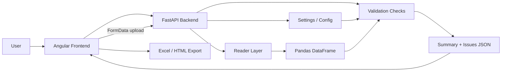

# AD Validation & Reconciliation Tool

## Executive architecture overview

This document captures the design intent, technical structure, and validation workflow for the AD Validation & Reconciliation Tool in a form that is suitable for both engineering review and stakeholder communication. The solution is built to support operational validation and reconciliation of identity data across source systems while keeping the user experience simple, traceable, and easy to extend.

The system is implemented as a modular full-stack application with two primary layers:

- Frontend: Angular 18 single-page application in [src](src)
- Backend: FastAPI service in [backend](backend)

The validation flow is intentionally clear and linear:

User uploads files in the Angular UI → Angular sends the payload to the API → FastAPI reads and normalizes the content → business validation rules are applied → structured findings are returned as JSON → Angular presents the results through summary metrics, issue tabs, and the data table.

---

## Technology stack

### Frontend

- Angular 18 — from [package.json](package.json)
- Angular Material — used in upload cards, tabs, buttons, dialogs
- TypeScript — app logic in [src](src)
- RxJS — reactive state and async handling
- XSLX — Excel export logic in [src/app/validation-page/validation-page.component.ts](src/app/validation-page/validation-page.component.ts)

### Backend

- Python
- FastAPI — API layer in [backend/app/main.py](backend/app/main.py)
- Pandas — data frame processing in [backend/app/reader.py](backend/app/reader.py)
- OpenPyXL — Excel reading support
- Pytest — tests in [backend/tests](backend/tests)

### Build and dev setup

- Angular CLI from [angular.json](angular.json)
- Proxy config in [proxy.conf.json](proxy.conf.json) to forward /api calls to the backend
- App runtime scripts in [package.json](package.json)

---

## Architecture diagram

This is a layered architecture:

- Presentation layer: Angular UI
- API layer: FastAPI
- Data parsing layer: reader logic
- Business rule layer: validation checks
- Configuration layer: settings constants
- Data contract layer: frontend TypeScript models

So the architecture is simple and layered:

- UI handles upload
- API handles orchestration
- reader parses files
- settings define constants
- checks run each validation rule
- response is returned to UI

---

## Where the architecture diagram is

There is no separate standalone architecture diagram artifact in the repository at this time. The architectural view is represented inline in this document so it remains easy to review alongside the implementation details and the validation flow. This keeps the documentation self-contained while preserving clarity for engineering and stakeholder audiences.

---

## File-by-file explanation

### [package.json](package.json)
This is the frontend package manifest.

It defines:

- dependencies
- scripts like start, build, and test
- Angular version and runtime packages

Why it exists:

- without it, the Angular app cannot install or run dependencies

How it works:

- npm start runs the Angular dev server
- Angular dev server proxies API calls using [proxy.conf.json](proxy.conf.json)
- the build script compiles the app for deployment

### [angular.json](angular.json)
This is the Angular project configuration file.

It defines:

- app name and project root
- build target
- serve target
- test target
- where the compiled output goes
- which CSS file is loaded globally

Why it exists:

- Angular uses this to know how to build, serve, and test the app

How it works:

- build uses the app entry file in [src/main.ts](src/main.ts)
- styles are loaded from [src/styles.css](src/styles.css)
- the app proxy is configured there too

### [proxy.conf.json](proxy.conf.json)
This is the local HTTP proxy file.

What it does:

- forwards requests like /api/validate to the backend running on localhost:8000

Why it exists:

- because the Angular frontend and backend run separately during local development

How it works:

- the browser calls /api/validate
- the proxy forwards it to the Python server
- this avoids CORS issues in local development

### [tsconfig.json](tsconfig.json)
This is the TypeScript compiler configuration.

It sets:

- strict mode
- modern JavaScript target
- DOM libraries
- decorator support
- source maps

Why it exists:

- TypeScript needs these rules so Angular can compile code correctly

How it works:

- the compiler reads this config before building the app
- it decides how TypeScript should be transpiled and checked

### [README.md](README.md)
This is the project documentation.

It explains:

- the purpose of the project
- the stack used
- how to run the app
- the folder structure
- the major project pieces

Why it exists:

- so developers can understand the app without reading every file manually

---

## Frontend structure

### [src/main.ts](src/main.ts)
This is the Angular bootstrap file.

It does:

- starts Angular
- loads the root app component
- attaches the app to the DOM

Why it exists:

- without it, nothing renders

How it works:

- bootstrapApplication(...) starts the app
- it passes the app configuration from [src/app/app.config.ts](src/app/app.config.ts)

### [src/index.html](src/index.html)
This is the HTML shell for the Angular app.

It contains:

- the document root
- base tag
- viewport settings
- Material Icons stylesheet
- the app-root container where Angular mounts

Why it exists:

- the browser needs a real HTML page before Angular renders the app

### [src/styles.css](src/styles.css)
This is the global style file.

It contains:

- color variables
- theme tokens
- typography rules
- shared layout styling

Why it exists:

- it keeps the design consistent across the entire application
- all pages use the same visual system

### [src/app/app.component.ts](src/app/app.component.ts)
This is the root Angular component.

It does:

- renders the application shell
- imports the main UI component

Why it exists:

- every Angular app needs a root component

### [src/app/app.config.ts](src/app/app.config.ts)
This is the app-wide configuration file.

It provides:

- router support
- HTTP client support
- animations

Why it exists:

- shared app providers are configured here

### [src/app/app.routes.ts](src/app/app.routes.ts)
This defines Angular routes.

Why it exists:

- it allows route-based navigation if more screens are added later

### [src/app/models.ts](src/app/models.ts)
This file contains shared TypeScript models used throughout the project.

It defines structures such as:

- validation issues
- validation summary
- response payload shape
- upload state

Why it exists:

- strong typing keeps the frontend predictable and reduces bugs

How it works:

- the backend returns JSON matching these shapes
- the frontend uses these types to manage data safely

### [src/app/validation.service.ts](src/app/validation.service.ts)
This is the API client layer for the frontend.

It does:

- creates a FormData payload
- sends it to /api/validate
- returns the typed backend response

Why it exists:

- the UI should not directly manage HTTP logic everywhere

How it works:

- the component calls runValidation(...)
- the HTTP client sends the form to the backend
- the result is converted into Angular data objects

---

## Main UI workflow files

### [src/app/validation-page/validation-page.component.ts](src/app/validation-page/validation-page.component.ts)
This is the central orchestration component for the validation workflow.

It handles:

- file selection for uploads
- sheet name inputs
- the Run Validation action
- loading state
- API execution
- parsing backend results
- result tab selection
- export actions

Why it exists:

- this is the heart of the application logic

How it works:

- the user selects files
- the component builds a FormData object
- it sends the files to the backend
- the backend returns validation summary and issue rows
- the component updates the UI state accordingly

### [src/app/validation-page/validation-page.component.html](src/app/validation-page/validation-page.component.html)
This is the page template for the primary validation experience.

It contains:

- upload sections
- comparison controls
- run validation button
- results area
- export controls

Why it exists:

- it defines what the user sees on the page

### [src/app/validation-page/validation-page.component.css](src/app/validation-page/validation-page.component.css)
This file styles the validation page.

It controls:

- panel layout
- spacing
- button styling
- results container design

Why it exists:

- the page should look structured and enterprise-ready rather than like a default form

---

## Reusable frontend components

### [src/app/upload-box/upload-box.component.ts](src/app/upload-box/upload-box.component.ts)
This is the reusable upload control component.

It supports:

- drag-and-drop upload
- file selection
- file preview
- optional sheet name input
- visual validation state

Why it exists:

- each upload field should behave consistently across the app

How it works:

- it emits file and sheet events to the parent page component
- the parent stores the selected data and decides whether it is valid

### [src/app/upload-box/upload-box.component.html](src/app/upload-box/upload-box.component.html)
This is the upload card template.

### [src/app/upload-box/upload-box.component.css](src/app/upload-box/upload-box.component.css)
This styles the drop zone and upload card.

---

### [src/app/summary-cards/summary-cards.component.ts](src/app/summary-cards/summary-cards.component.ts)
This component creates summary metric cards from validation results.

It renders:

- total counts
- DC failures
- mismatches
- inactive items
- stale login counts
- missing Azure items

Why it exists:

- users need a quick overview before reading the detailed table

### [src/app/summary-cards/summary-cards.component.html](src/app/summary-cards/summary-cards.component.html)
This renders the summary card layout.

### [src/app/summary-cards/summary-cards.component.css](src/app/summary-cards/summary-cards.component.css)
This styles the metric cards.

---

### [src/app/result-table/result-table.component.ts](src/app/result-table/result-table.component.ts)
This is the result table logic.

It handles:

- keyword search
- pagination
- page size
- filtered rows
- status chips

Why it exists:

- backend responses can be large, so the UI needs a clean structured table

How it works:

- rows are filtered by the search text
- the current page slice is computed based on page size and page index
- the footer shows the visible range

### [src/app/result-table/result-table.component.html](src/app/result-table/result-table.component.html)
This is the table template.

### [src/app/result-table/result-table.component.css](src/app/result-table/result-table.component.css)
This styles the table and status chips.

---

### [src/app/configure-columns-dialog/configure-columns-dialog.component.ts](src/app/configure-columns-dialog/configure-columns-dialog.component.ts)
This component provides a dialog for choosing which table columns to display.

Why it exists:

- it makes the result table adjustable without hard-coding every column

How it works:

- the dialog lists available columns
- the user selects or removes columns
- Save closes the dialog and updates the table view

### [src/app/shell/shell.component.ts](src/app/shell/shell.component.ts)
This is the outer app shell.

It wraps:

- the top header
- branding area
- the main content region

Why it exists:

- the app should feel like a dashboard or portal instead of a bare page

### [src/app/shell/shell.component.html](src/app/shell/shell.component.html)
This is the shell template.

### [src/app/shell/shell.component.css](src/app/shell/shell.component.css)
This styles the shell and header area.

---

## Backend structure

### [backend/app/main.py](backend/app/main.py)
This is the main FastAPI application entry point.

It defines:

- health route
- validate route
- file validation
- required-column checks
- aggregation of rule outputs

Why it exists:

- it is the backend hub for the whole app

How it works:

- receives uploaded files
- validates file type and size
- confirms required columns exist
- calls each validation rule module
- combines the results into a JSON response

### [backend/app/settings.py](backend/app/settings.py)
This is the configuration center.

It contains:

- expected data center names
- required column definitions
- validation thresholds
- file size rules
- allowed file extensions

Why it exists:

- rules should be centralized instead of duplicated across modules

### [backend/app/reader.py](backend/app/reader.py)
This is the file parsing layer.

It does:

- reads CSV or Excel files
- normalizes headers
- cleans values
- returns a DataFrame

Why it exists:

- validation checks need a consistent structure before business logic runs

### [backend/app/auth.py](backend/app/auth.py)
This is the authentication stub.

It exposes a user context function and acts as a placeholder for future identity or portal access integration.

Why it exists:

- the route pattern is ready for real authentication later

---

## Validation check modules

These are all located in [backend/app/checks](backend/app/checks).

### [backend/app/checks/dc_count.py](backend/app/checks/dc_count.py)
Checks whether all expected data centers are present.

### [backend/app/checks/name_match.py](backend/app/checks/name_match.py)
Finds name mismatches between source datasets.

### [backend/app/checks/inactive.py](backend/app/checks/inactive.py)
Finds accounts that should be disabled or treated as inactive.

### [backend/app/checks/last_login.py](backend/app/checks/last_login.py)
Finds stale login records older than the configured threshold.

### [backend/app/checks/in_azure.py](backend/app/checks/in_azure.py)
Finds records that are not present in Azure data.

Why these modules exist:

- each rule is separate and easy to test
- business logic remains modular instead of being buried in one huge function

How they work:

- each function receives a filtered DataFrame
- it computes invalid entries
- it returns structured issue objects with account and reason details

---

## How the whole app works together

1. The user opens the app in the browser.
2. Angular renders the upload cards and summary area.
3. The user selects the relevant file inputs.
4. Angular validates the file input on the client side.
5. The user clicks Run Validation.
6. The frontend builds a multipart form and sends it to the API.
7. The FastAPI route in [backend/app/main.py](backend/app/main.py) receives the files.
8. The reader converts the files to DataFrames.
9. The settings file confirms required columns and thresholds.
10. Each validation rule analyzes the data.
11. Results are returned as a JSON object.
12. Angular updates the summary cards and results table.
13. The user can export the output to Excel or HTML.

---

## Short answer to “what is the architecture?”

This app follows a classic layered architecture:

- Presentation layer: Angular UI
- API layer: FastAPI
- Data parsing layer: reader
- Business rule layer: validation checks
- Configuration layer: settings
- Data contract layer: models

This separation keeps the system clean, easier to maintain, and simpler to extend with more validation rules over time.

---

## Final summary

This project is a full-stack AD validation system designed to compare records and identify mismatches, inactive items, stale login activity, and Azure gaps. The main architecture is simple but effective:

- Angular handles the user interface
- FastAPI handles the API and validation orchestration
- Pandas processes the uploaded file data
- rule modules enforce business logic independently
- the UI displays structured results and exports them when needed

This is a good balance of clarity, maintainability, and implementation speed for a validation-focused application.

The main architecture is:

- Frontend UI in Angular
- Backend API in FastAPI
- Data processing in Pandas
- Validation rules separated by concern
- Results shown in a dashboard-like interface

The whole system is designed to be easy to understand, maintain, and extend as new validation rules are added.
