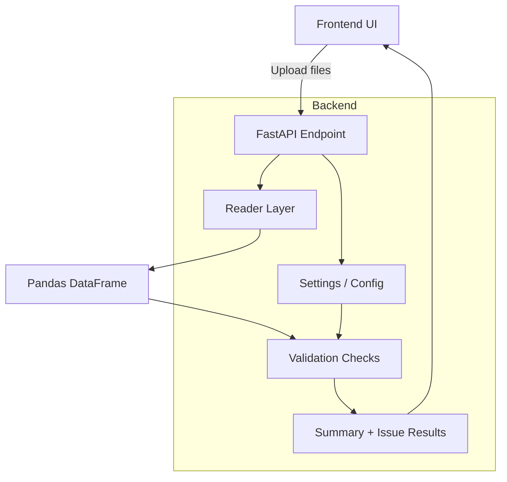

# AD Validation & Reconciliation Tool - Backend Documentation

## Overview

The backend is the validation and reconciliation engine for the AD Validation & Reconciliation Tool. It receives uploaded files from the Angular frontend, normalizes the input data, applies business validation rules, and returns a structured response that the UI renders as summary cards, tabs, and detailed issue tables.

The backend is implemented with Python and FastAPI, with a modular rule-driven design that keeps validation logic separate from the API layer and the data readers.

---

## Purpose

The backend exists to:

- accept uploaded source files from the frontend
- parse Excel and CSV content
- normalize column names and values
- compare identity data across systems
- run validation checks against business rules
- return results to the UI in a structured, machine-readable format

This design keeps the business logic testable, maintainable, and easy to extend as new validation rules are added.

---

## High-level architecture

The backend follows a layered pattern:

- API layer: handles HTTP requests and responses
- Reader layer: loads and prepares file content
- Settings layer: holds validation constants and configuration
- Check modules: isolate individual business rules
- Response assembly: combines issues and summary metrics

Simplified flow:

Client upload → FastAPI route → reader parses file → settings define expected rules → validation checks evaluate data → summary + issues returned to frontend

## Backend architecture diagram



This diagram shows the backend as a lightweight orchestration layer: it receives input, prepares data, applies validation rules, and returns a structured result set to the frontend.

---

## Technology stack

### Python
Python provides the application runtime and the data-processing foundation.

### FastAPI
FastAPI provides the API layer, request handling, and response serialization. It is used for the validation endpoint that receives uploaded files and returns structured JSON results.

### Pandas
Pandas is used for tabular data handling. It enables reading uploaded files into DataFrames, normalizing columns, cleaning values, and simplifying rule evaluation.

### OpenPyXL
OpenPyXL is used to read Excel workbooks so that the service can process spreadsheet-based AD and Azure exports.

### Pytest
Pytest is used for backend validation tests such as health checks and reader verification.

---

## Key files

### [backend/app/main.py](backend/app/main.py)
This is the main FastAPI application entry point.

It is responsible for:

- creating the FastAPI app instance
- defining API routes
- accepting uploaded files
- invoking the validation workflow
- returning summary and issue payloads to the frontend

The main route is the validation endpoint that receives file uploads and triggers business validation.

### [backend/app/reader.py](backend/app/reader.py)
This module reads uploaded files and converts them into normalized data structures.

It handles:

- file type detection
- reading Excel or CSV data
- standardizing column names
- cleaning values
- preparing data for rule checks

This layer exists to isolate parsing logic from the validation rules themselves.

### [backend/app/settings.py](backend/app/settings.py)
This file acts as the configuration source for the validation logic.

It stores:

- expected data center names
- required fields and column mappings
- validation thresholds
- upload size limits
- allowed file formats and related configuration constants

Centralizing these values makes the rules easier to maintain and adapt to changing business requirements.

### [backend/app/auth.py](backend/app/auth.py)
This file is a placeholder for authentication or identity integration logic.

It is intended for future use with a unified portal or shared identity provider, but it is not the core validation engine in the current implementation.

### [backend/app/checks](backend/app/checks)
This directory contains modular validation rules, each focused on a specific condition.

#### [backend/app/checks/dc_count.py](backend/app/checks/dc_count.py)
Checks whether expected data centers are represented and valid.

#### [backend/app/checks/name_match.py](backend/app/checks/name_match.py)
Compares account identifiers and flags mismatches between identity sources.

#### [backend/app/checks/inactive.py](backend/app/checks/inactive.py)
Finds accounts that are active in data but should be disabled, or are otherwise considered inactive for remediation.

#### [backend/app/checks/last_login.py](backend/app/checks/last_login.py)
Flags stale accounts based on login history thresholds.

#### [backend/app/checks/in_azure.py](backend/app/checks/in_azure.py)
Checks whether a user or account exists in Azure or is missing from Azure identity coverage.

Each validation rule is isolated so it can be reviewed, tested, and modified independently.

---

## Request flow

The backend request lifecycle is designed to be simple and traceable.

1. The frontend sends uploaded files through the validation endpoint.
2. FastAPI receives the request and extracts the incoming form data.
3. The reader layer loads the files and normalizes the records.
4. Validation checks run against the prepared dataset.
5. The backend builds a summary object and a list of detailed issues.
6. The frontend receives the result payload and renders the dashboard.

This process ensures that validation is centralized in the backend rather than distributed inside the UI.

---

## Validation outcome format

The backend returns structured results that include:

- summary metrics
- total counts of issues by category
- detailed rows or records that failed validation
- metadata used by the frontend to render charts, cards, and tables

This makes the API suitable for both UI rendering and future export or reporting features.

---

## Test files

### [backend/tests/test_health.py](backend/tests/test_health.py)
Confirms that the health endpoint is responding correctly.

### [backend/tests/test_reader.py](backend/tests/test_reader.py)
Verifies that uploaded files are read and normalized as expected by the reader layer.

These tests provide basic verification for the service without coupled UI dependencies.

---

## Why the backend is structured this way

The backend is intentionally modular for several reasons:

- easier maintenance: each rule is isolated
- simpler testing: each module can be validated independently
- better scalability: rules can be added without rewriting the API layer
- clearer ownership: data parsing and validation logic are separated cleanly

This structure supports both current validation needs and future extension opportunities.

---

## Local backend setup

```bash
cd backend
python -m venv .venv
.venv\Scripts\activate
pip install -r requirements.txt
uvicorn app.main:app --reload --host 0.0.0.0 --port 8000
```

---

## Summary

The backend is the processing and decision-making layer of the AD validation solution. It is responsible for reading source files, applying identity-validation rules, and returning actionable results to the frontend in a structured format.

Its design keeps the API thin, the validation logic explicit, and the system maintainable for future enhancements.
